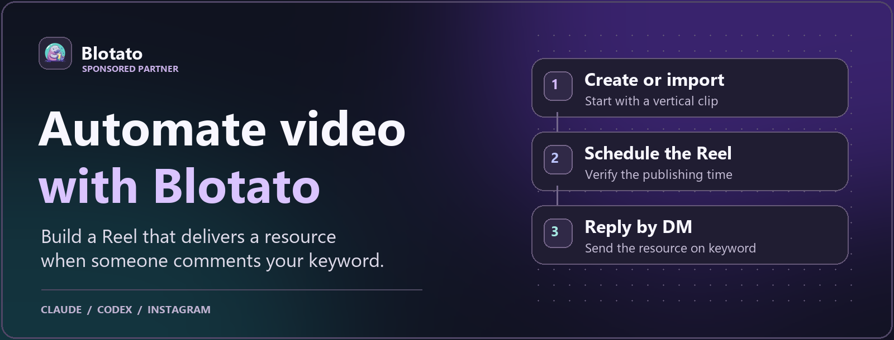

  <h1>Automate Video with Blotato</h1>
  

    
    
    
    
  

  
  

    <strong><a href="#course-roadmap">Start the course</a></strong> ·
    <a href="#blotato-skills-for-claude-and-codex">Copy the skills</a> ·
    <a href="./skills/blotato/project.md">Run the project</a> ·
    <a href="https://blotato.com/?ref=chrisl9">Explore Blotato</a>
  

## Blotato publishing and DM workflows

Use Blotato’s web app to create media and manage the calendar, or connect Claude or Codex to run the publishing and DM workflows from a chat. The final lesson shows how to move the same workflow into n8n, Make, or your own application. [Blotato feature overview](https://www.blotato.com/social-media-scheduler?ref=chrisl9)

## Blotato skills for Claude and Codex

Copy a prompt to try it in Claude or Codex, or open the standalone skill file.

| Schedule a Reel | Set up Instagram comment-to-DM |
| --- | --- |
| Choose a connected account and queue your clip at the exact time you approve. | Set up a keyword trigger and test the private reply from a second account. |
| **[Copy the scheduling prompt →](./skills/blotato/README.md#schedule-a-finished-clip)** · [SKILL.md](./skills/blotato/blotato-schedule-video/SKILL.md) | **[Copy the DM prompt →](./skills/blotato/README.md#set-up-instagram-comment-to-dm)** · [SKILL.md](./skills/blotato/blotato-instagram-comment-to-dm/SKILL.md) |

**[Open the skills folder and setup guide →](./skills/blotato/README.md)**

## Start here: Sabrina’s Blotato walkthrough

**Jump to a chapter** · [4:34 Calendar](https://www.youtube.com/watch?v=o5GsAxEX-Bk&t=274s) · [5:51 Media and visuals](https://www.youtube.com/watch?v=o5GsAxEX-Bk&t=351s) · [9:57 Analytics](https://www.youtube.com/watch?v=o5GsAxEX-Bk&t=597s) · [10:37 DM automation](https://www.youtube.com/watch?v=o5GsAxEX-Bk&t=637s) · [11:59 Assistant setup](https://www.youtube.com/watch?v=o5GsAxEX-Bk&t=719s)

## GitHub star history

## Course roadmap

Start with one Reel and one keyword reply. Once that works, extend the workflow to other platforms and automate the handoff from a content sheet.

| Lesson | What you'll do |
| --- | --- |
| [1. Connect Blotato](#1-connect-blotato) | Connect a test Instagram profile and verify it in Claude or Codex. |
| [2. Create or import a clip](#2-create-or-import-a-clip) | Produce a short vertical video and prepare its caption. |
| [3. Schedule the Reel](#3-schedule-the-reel) | Queue the clip for an exact future time and verify the result. |
| [4. Set up a keyword reply](#4-set-up-a-keyword-reply) | Review and test an Instagram comment-to-DM rule. |
| [5. Repurpose and cross-post](#5-repurpose-and-cross-post) | Adapt the idea and clip for another platform. |
| [6. Review replies and results](#6-review-replies-and-results) | Use the inbox and post metrics to plan the next clip. |
| [7. Build a repeatable workflow](#7-build-a-repeatable-workflow) | Use n8n, Make, or the API to queue approved content. |

## Build your first Reel-to-DM workflow

> [!NOTE]
> For the project, you'll need an Instagram professional test profile, a second account to test the comment, a Blotato plan with MCP access, and a resource URL you control.

### 1. Connect Blotato

1. Connect an Instagram professional test profile in Blotato. The agent exercises require a Blotato plan with MCP access.
2. Follow the [Claude setup guide](https://www.blotato.com/claude?ref=chrisl9) or the [Codex setup guide](https://www.blotato.com/codex?ref=chrisl9).
3. In a new conversation, ask the assistant to list the connected Blotato accounts. Confirm that the profile you intend to use appears before continuing.
4. Open Blotato's calendar. This is where you'll cross-check the account, time, and queued post after the assistant schedules it. Keep any API key in your connector or automation credential store.

**Watch:** [Sabrina connects Claude to Blotato and demonstrates scheduling and DM automation](https://www.youtube.com/watch?v=PakM11AJAlE). Use the setup links above if the connection screen looks different.

### 2. Create or import a clip

For the course project, make a short vertical clip that teaches one useful idea. For example, show viewers three ways to plan a faceless Reel and offer a link to your checklist.

- **Create in Blotato.** In **Videos → New**, choose a template or **Create Everything with AI Agent**. Describe the scenes, narration, and on-screen text. Review the preview, edit the captions or visuals, and export when ready. AI image and video generation can use credits. [Blotato video creation help](https://help.blotato.com/support/faqs?ref=chrisl9)
- **Bring your own clip.** Export a vertical MP4 from your preferred editor. Keep the file handy or use a video URL that your assistant can access.

**Try this creative brief:** `Create a short vertical faceless Reel teaching three steps for planning a video: pick one viewer question, write a one-sentence hook, and end with one clear action. Use readable captions and end by asking viewers to comment CLIPGUIDE26 for the checklist.`

Pick a resource URL you control and a distinctive keyword such as `CLIPGUIDE26`. For this project, use the caption `Comment CLIPGUIDE26 and I'll DM you the faceless video checklist.` Review the clip, caption, and link before scheduling.

### 3. Schedule the Reel

Open the [scheduling skill](./skills/blotato/README.md#schedule-a-finished-clip) and copy its prompt into Claude or Codex. Supply your MP4 or video URL, the test profile, the project caption, and a future date and time with a timezone. Approve the exact account, clip, caption, and schedule.

For a dashboard-only run, add the clip to a draft in **Remix**, select the connected test profile, and use the scheduling option to choose the date and time. Check the calendar before leaving the app. For this exercise, use an exact time. Set up calendar slots before using the next-open-slot option. [Blotato scheduling FAQ](https://help.blotato.com/support/faqs?ref=chrisl9)

> **Check your work:** Blotato reports the submission as scheduled and the calendar shows the correct clip and time. Let it publish on the test profile if you're continuing to Lesson 4. If you only want to test scheduling, remove it from the queue before it goes live.

### 4. Set up a keyword reply

Once the Reel is live, open the [Instagram comment-to-DM skill](./skills/blotato/README.md#set-up-instagram-comment-to-dm). Supply the published Reel, test profile, same keyword, and your resource URL. Review the trigger scope and message while the rule is inactive. If the Reel can't be selected, approve any account-wide trigger separately and use a dedicated test profile.

> **Check your work:** After approving activation, comment with the keyword from a second account and confirm the private reply contains the right link. Try an unrelated comment to check that it receives no reply. Disable the rule after the test.

[Open the Blotato skills guide and copy both prompts →](./skills/blotato/README.md)

#### Watch the Blotato DM automation case study

**How I Made $120K with a Simple Instagram DM Strategy** · Shared by the Blotato team. Watch how Sabrina connects the Reel’s keyword to a useful resource, then apply the setup to your test profile.

> [!TIP]
> **Run the full project.** Use the [project checklist](./skills/blotato/project.md) to verify the calendar entry, test the private reply, and troubleshoot both steps.

## Extend the workflow

### 5. Repurpose and cross-post

1. Start with your own script, article, or video URL. Add it as a source in Remix or ask your connected assistant to use it to draft a post. Review the draft for accuracy and match the language to the destination.
2. Reuse the finished clip with a platform-specific caption. For example, write an Instagram caption that calls out the DM keyword and a separate TikTok caption with a CTA that works there.
3. Review each account, media item, and time. In the API, submit one post per destination account and track each submission separately. Confirm the post is queued on each destination before treating the batch as scheduled.

> **Check your work:** Two reviewed drafts or queued posts, each tied to the intended account. A draft-only run is enough to complete this lesson.

[Blotato cross-platform publishing guide](https://help.blotato.com/blog/post-videos-tiktok-reels-shorts-one-workflow?ref=chrisl9) · [Blotato source and repurposing examples](https://www.blotato.com/codex?ref=chrisl9)

### 6. Review replies and results

1. Ask Blotato to show recent comments or conversations for your connected Instagram or Facebook account. Draft any response you want to send and review it before posting.
2. Ask for the Reel's available post metrics and write down its views and comments at a consistent time after publication. Compare posts from the same platform and similar reporting windows. Metrics depend on the destination. Blotato's guide currently lists LinkedIn publishing with no metrics.
3. In the DM automation view, check triggered, completed, and failed runs. Record what went wrong on any failed test and change one thing for the next clip, such as the caption or keyword.

> **Check your work:** One observation from published-post metrics or the test automation and one change to try next.

[Blotato inbox and analytics capabilities](https://www.blotato.com/social-media-scheduler?ref=chrisl9) · [DM automation guide](https://www.blotato.com/blog/how-to-sell-dm-automation?ref=chrisl9)

### 7. Build a repeatable workflow

Start with a sheet containing one row per destination account. Use columns for clip URL, caption, account, exact date and time with timezone, approval status, submission ID, and result.

1. Run one approved row through the Blotato action in n8n or your Make/API workflow. Map the row's account and scheduled time to the request.
2. Save the submission ID back to the row and look up its status. Mark the row scheduled only after Blotato confirms it.
3. If a run stops after submitting, check the saved ID or the calendar before resubmitting. Once one row works, repeat with a second destination and verify each result separately.

> **Check your work:** One approved row becomes exactly one queued post at the expected time.

[Blotato's n8n and Make scheduling walkthrough](https://help.blotato.com/blog/build-social-media-scheduler-n8n-make?ref=chrisl9)

## Watch more Blotato builds

| If you want to practice… | Watch Sabrina build it |
| --- | --- |
| Ongoing content creation in Claude | [How I Automate Content With Claude + Blotato](https://www.youtube.com/watch?v=GhY_F5asC4I) |
| Bringing files into a publishing workflow | [From Google Drive to Social Media](https://www.youtube.com/watch?v=N4Q4iM05PPc) |
| Sending content to multiple platforms with n8n or Make | [Post Everywhere on Autopilot, Part 2](https://www.youtube.com/watch?v=kJibIOIc2aA) |
| Building a second media format | [Instagram Carousel Machine With n8n, Make, and Blotato](https://www.youtube.com/watch?v=oMiBByDQ6eM) |

Use these as examples of the workflow. Follow the official docs linked in each lesson for current screens, access requirements, and connector fields.

---

## Other tools and archived lessons

The [ViralWave Studio course archive](./course/README.md) indexes the original lessons, reference guides, and planning resources. ViralWave Studio's video creation feature is currently paused, so the creation lessons reflect an earlier version of the product.

**Disclosure:** Blotato sponsors this placement. The Blotato signup links are referral links.
